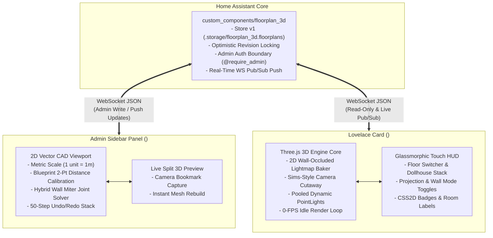

# Home Assistant 3D Floorplan Editor & Card (`floorplan_3d`)

[](https://github.com/JohNan/homeassistant-floorplan_3d/releases)
[](https://hacs.xyz)
[](LICENSE)

An all-in-one HACS integration pairing an **admin-only 2D/3D CAD floorplan sidebar editor** with a **wall-tablet-optimized Three.js 3D Lovelace card** for Home Assistant.

---

## Architecture & Engineering Highlights



### 1. Hybrid 2D Wall-Occluded Lightmap Baker (Zero Light Bleed)
Point lights in standard 3D engines either bleed through walls or require expensive per-light 6-sided shadow cubemaps that overwhelm mobile and wall-tablet GPUs. `floorplan_3d` computes room-bounded light occlusion using an angular ray-sweep visibility polygon ($O(V \log V)$) clipped against wall edges and closed doors, baked into an offscreen additive 2D floor texture (`512x512`). Wall and room shaders sample this texture at zero runtime shadow pass cost.

### 2. Wall-Tablet 0-FPS Idle Loop
Smart home dashboards run 24/7 on wall tablets. Rather than executing an unconditional 60 FPS loop, `RenderLoopController` maintains a dirty flag. When no touch gestures are active, camera damping has settled, and transitions (300ms light lerps, 400ms door swings) are complete, the engine suspends `requestAnimationFrame`, achieving **0% GPU utilization at idle**.

### 3. $O(1)$ Watched-Entity State Diffing
Home Assistant pushes entire state dictionaries on every entity change. `WatchedEntityDiffer` constructs a strict `Set<string>` containing only the entities placed on the active floorplan, door contact sensors, and bound room area sensors. State diffing is $O(1)$ relative to total smart home size.

### 4. Sims-Style Camera-Facing Dynamic Wall Cutaway
In `auto_cutaway` mode, wall segments evaluate horizontal view alignment $d = \vec{n}_{\text{xz}} \cdot \text{normalize}(\vec{p}_{\text{cam,xz}} - \vec{m}_{\text{xz}})$. Any front wall obstructing the camera view smoothly scales down to 0.35m cross-sections, preserving back-wall enclosure and line of sight.

### 5. Wall-Tablet Security Boundary
Mutation commands (`floorplan_3d/save`, `floorplan_3d/delete`, `floorplan_3d/upload_blueprint`) strictly enforce Home Assistant admin privileges (`require_admin=True`). Viewing and real-time subscription commands (`floorplan_3d/list`, `floorplan_3d/get`, `floorplan_3d/subscribe`) are accessible to non-admin tablet accounts.

---

## Installation via HACS

1. Open **HACS** in your Home Assistant sidebar.
2. Select **Integrations** > **Custom repositories** (top-right menu).
3. Add `https://github.com/JohNan/homeassistant-floorplan_3d` with category **Integration**.
4. Click **Download**, then restart Home Assistant.
5. In Home Assistant, navigate to **Settings** > **Devices & Services** > **Add Integration**.
6. Search for **3D Floorplan Editor & Card** (`floorplan_3d`) and complete setup.

The integration automatically registers the admin sidebar panel (`Floorplan 3D Editor`) and injects the Lovelace card resource (`/floorplan_3d_static/floorplan-card.js`).

---

## Quick-Start Usage Guide

### Step 1: Author Your Floorplan in the Sidebar Editor
1. Click **Floorplan 3D Editor** in your Home Assistant sidebar (admin accounts only).
2. Click **Calibrate Blueprint**, upload an architectural floorplan or sketch (`PNG`, `JPG`, `WEBP`), click two points with known separation, and enter the distance in meters.
3. Select the **Wall Tool (`W`)** and trace exterior and interior walls. Corners automatically calculate miter joints and bevel acute angles.
4. Select the **Room Polygon Tool (`R`)** and trace enclosed rooms. In the right Inspector, bind each room to its Home Assistant **Area** and choose floor materials (`wood_oak`, `tile_slate`, `carpet`, etc.).
5. Select the **Opening Tool (`O`)** to insert doors and windows onto walls. Bind doors to contact sensors (`binary_sensor.*`) for live 3D opening swings.
6. Drag lights, fans, TVs, media players, and sensors from the left **HA Entities Palette** into rooms.
7. Orbit the split 3D viewport to your preferred perspective and click **Save View as Default Camera**.
8. Click **Save Floorplan**.

### Step 2: Add the 3D Card to Your Dashboard
Open any Lovelace dashboard, click **Add Card**, and choose **3D Floorplan Card** using the Visual Card Editor, or add via YAML:

```yaml
type: custom:floorplan-3d-card
floorplan_id: main_house
height: 540
wall_mode: auto_cutaway
camera_projection: perspective
ambient_mode: adaptive_contrast
quality_tier: auto
show_floor_selector: true
show_wall_mode_toggle: true
show_reset_camera: true
show_room_labels: true
show_entity_badges: true
```

---

## Card Configuration Reference

| Option | Type | Default | Description |
| :--- | :--- | :--- | :--- |
| `type` | `string` | **Required** | Must be `custom:floorplan-3d-card`. |
| `floorplan_id` | `string` | **Required** | The ID of the floorplan document created in the sidebar editor. |
| `default_floor_id` | `string` | `null` | Initial active floor level. Defaults to Ground Floor (`level_index: 0`). |
| `height` | `number` | `520` | Fixed viewport height in pixels. |
| `camera_projection` | `string` | `'perspective'` | Camera view: `'perspective'` (True 3D) or `'orthographic'` (Isometric). |
| `wall_mode` | `string` | `'auto_cutaway'` | Wall rendering: `'auto_cutaway'` (Sims-style), `'half'` (cross-section), or `'full'` (enclosed). |
| `ambient_mode` | `string` | `'adaptive_contrast'` | Environment lighting: `'adaptive_contrast'`, `'sun_sync'` (tracks `sun.sun`), `'dark'`, or `'daylight'`. |
| `quality_tier` | `string` | `'auto'` | Hardware profile: `'auto'`, `'tablet'` (capped lights/pixel ratio), `'high'`, or `'low'`. |
| `show_floor_selector` | `boolean` | `true` | Display top-left floor switcher pill bar and dollhouse stack button. |
| `show_wall_mode_toggle`| `boolean` | `true` | Display top-right wall cutaway toggle button. |
| `show_reset_camera` | `boolean` | `true` | Display top-right button to restore saved camera bookmark. |
| `show_room_labels` | `boolean` | `true` | Display floating CSS2D room labels with live temperature & humidity. |
| `show_entity_badges` | `boolean` | `true` | Display touchable CSS2D badges for placed lights, switches, and sensors. |
| `enable_room_zoom_on_tap` | `boolean` | `false` | Smoothly center and focus camera on a room when tapping its floor slab. |

---

## Development & Toolchain

The project uses `mise` to manage Node.js 22 and Python 3.12/3.14 environments.

```bash
# Run TypeScript typechecking and Python ruff linter
mise run lint

# Run Vitest unit & integration test suite
mise run test

# Run Python backend pytest suite (storage, revision locking, WS commands)
mise run test:py

# Build production ES module bundles into custom_components/floorplan_3d/frontend/dist/
mise run build
```

---

## License

This project is licensed under the MIT License — see the [LICENSE](LICENSE) file for details.
