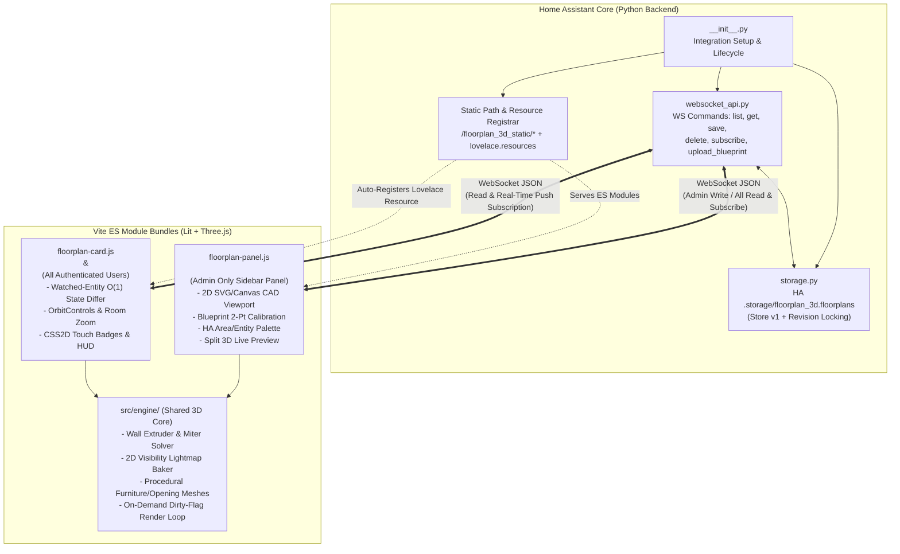
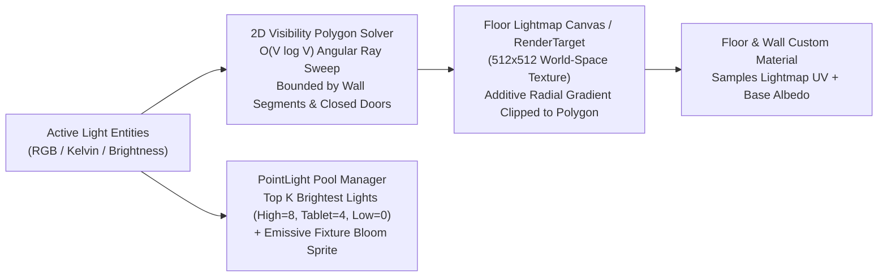

# Home Assistant 2D Floorplan Editor & 3D Lovelace Card (`floorplan_3d`) — Technical Specification

## 1. Executive Summary & System Overview

`floorplan_3d` is a HACS-compatible Home Assistant integration (`custom_components/floorplan_3d`) that combines:
1. **Admin-Only 2D/3D Sidebar Editor Panel (`<floorplan-editor-panel>`)**: An interactive CAD-like 2D floorplan authoring workspace with metric coordinates (`1 unit = 1 meter`), 2-point blueprint image scale calibration, a hybrid Node-Edge wall graph with explicit room polygons, Home Assistant `area_registry` / `floor_registry` binding, drag-and-drop entity placement, procedural furniture placement, a live split-screen 3D preview pane, camera bookmarking, and a 50-step undo/redo history stack.
2. **Wall-Tablet Optimized 3D Lovelace Card (`<floorplan-3d-card>`)**: A Three.js WebGL interactive bird's-eye view card featuring a hybrid 2D wall-occluded visibility lightmap (preventing light bleed through walls without expensive cubemap shadow passes per light), pooled dynamic `PointLight`/`SpotLight` shading, dynamic "Sims-style" camera-facing wall cutaway, animated 3D entity effects (point/spot/LED-strip lights, door/window contact sensor swings, motion sensor room pulses, TV screen glow, spinning ceiling fans), and touch-friendly floating entity badges supporting standard Home Assistant actions (`tap_action`, `hold_action`, `double_tap_action`).

### 1.1 Architectural Diagram



---

## 2. Packaging, Backend Storage & Security Architecture

### 2.1 HACS Packaging Constraint & Single-Integration Strategy
HACS repositories must belong to a single category (`integration` or `plugin`). By packaging `floorplan_3d` as a **HACS Integration** (`custom_components/floorplan_3d` with `content_in_root: false` in `hacs.json`):
- The Python integration serves pre-compiled frontend ES module bundles from `custom_components/floorplan_3d/frontend/dist/` via `hass.http.async_register_static_paths`.
- During `async_setup_entry`, the integration automatically:
  1. Registers the custom sidebar panel (`floorplan-3d-editor`) via `frontend.async_register_built_in_panel(..., require_admin=True)`.
  2. Registers `/floorplan_3d_static/floorplan-card.js?v=<VERSION>` into Home Assistant's Lovelace resource collection (`hass.data["lovelace"].resources`) when Lovelace runs in `storage` mode, eliminating manual resource configuration.

### 2.2 Storage Layer (`homeassistant.helpers.storage.Store`)
- **Storage Key**: `floorplan_3d.floorplans`
- **Storage Version**: `1`
- **Why `.storage/` over Entity State/Attributes**: Home Assistant entity states are strictly capped at 255 characters, and state attributes >16 KB bloat the SQLite/MariaDB Recorder database on every change. `.storage/` supports multi-megabyte JSON documents with atomic async writes (`async_delay_save` / `async_save`).
- **Blueprint Asset Storage**: Uploaded floorplan reference blueprints (`PNG`, `JPG`, `WEBP`, `SVG`) are saved under `/config/www/floorplan_3d/blueprints/<floorplan_id>_<floor_id>_<hash>.<ext>` (served via `/local/floorplan_3d/blueprints/...`) via an admin-only WebSocket command (`floorplan_3d/upload_blueprint`).

### 2.3 Access Control & Concurrency Model
| WebSocket Command | Permission | Purpose |
| :--- | :--- | :--- |
| `floorplan_3d/list` | Authenticated User | Returns lightweight metadata (`id`, `name`, `revision`, `updated_at`, `floors: [{id, name}]`) for all saved floorplans. |
| `floorplan_3d/get` | Authenticated User | Returns the full `FloorplanDocument` for a given `floorplan_id`. |
| `floorplan_3d/save` | **Admin Only** (`@require_admin`) | Validates schema, checks `expected_revision` (optimistic concurrency control to prevent clobbering concurrent edits), increments `revision`, persists to `.storage/`, and broadcasts `floorplan_updated` to all active subscribers. |
| `floorplan_3d/delete` | **Admin Only** (`@require_admin`) | Deletes a floorplan document and associated blueprint images, broadcasting `floorplan_deleted`. |
| `floorplan_3d/upload_blueprint` | **Admin Only** (`@require_admin`) | Accepts base64-encoded image payload, validates MIME type & max size (15 MB), writes to `/config/www/floorplan_3d/blueprints/`, and returns the `/local/...` URL. |
| `floorplan_3d/subscribe` | Authenticated User | Subscribes open Lovelace cards and editor instances to real-time push notifications whenever `floorplan_id` is saved or deleted. |

---

## 3. Complete Data Model & Schema (`STORAGE_VERSION = 1`)

All spatial coordinates are stored in **meters (`m`)** in a right-handed 2D floor coordinate system where:
- Origin `(0, 0)` is the center of the canvas.
- `+X` points East (right in 2D), `+Y` points South (down in 2D), which maps in Three.js 3D world space to `(x, elevation + z, y)` where `+Y_3D` is vertical up (`elevation`).

```typescript
export interface FloorplanStoreData {
  version: 1;
  floorplans: Record<string, FloorplanDocument>;
}

export interface FloorplanDocument {
  id: string;                      // UUID v4 or slug (e.g., "main_house")
  name: string;                    // Display name (e.g., "Main House")
  revision: number;                // Monotonically increasing integer for optimistic locking
  created_at: string;              // ISO-8601 UTC timestamp
  updated_at: string;              // ISO-8601 UTC timestamp
  unit: 'm';                       // Canonical world unit: meters
  grid_size: number;               // Default snap grid in meters (e.g., 0.1m = 10cm)
  ambient_config: AmbientConfig;
  floors: FloorLevel[];            // Ordered by level_index ascending
}

export interface AmbientConfig {
  mode: 'adaptive_contrast' | 'sun_sync' | 'dark' | 'daylight';
  sun_entity_id: string;           // Default: "sun.sun"
  base_ambient_intensity: number;  // 0.05 - 1.0 (default 0.22 in adaptive_contrast)
  wall_color: string;              // Default "#e2e8f0"
  floor_color: string;             // Default "#334155"
  background_color: string;        // Default "#0f172a"
}

export interface FloorLevel {
  id: string;                      // UUID v4
  name: string;                    // e.g., "Ground Floor", "First Floor"
  level_index: number;             // e.g., 0, 1, -1 (Basement)
  elevation: number;               // Base Y elevation in meters (e.g., 0.0, 2.8, -2.6)
  wall_height: number;             // Default wall extrusion height in meters (e.g., 2.6)
  slab_thickness: number;          // Floor slab thickness in meters (default: 0.15)
  ha_floor_id: string | null;      // Bound Home Assistant floor_registry ID
  blueprint: BlueprintCalibration | null;
  default_camera: CameraBookmark | null;
  nodes: WallNode[];               // Shared 2D vertices for wall graph
  walls: WallEdge[];               // Wall segments connecting two WallNodes
  openings: WallOpening[];         // Doors, windows, archways anchored to a WallEdge
  rooms: RoomPolygon[];            // Explicit closed room polygons
  furniture: FurnitureItem[];      // Procedural 3D furniture items
  entities: EntityPlacement[];     // Placed Home Assistant entities
}

export interface BlueprintCalibration {
  image_url: string;               // "/local/floorplan_3d/blueprints/..."
  opacity: number;                 // 0.0 - 1.0 (default 0.45)
  locked: boolean;
  /** World-space center offset in meters */
  offset_x: number;
  offset_y: number;
  rotation_deg: number;
  /** Computed from 2-point calibration: real_distance_m / pixel_distance */
  meters_per_pixel: number;
  natural_width_px: number;
  natural_height_px: number;
}

export interface CameraBookmark {
  projection: 'perspective' | 'orthographic';
  position: [number, number, number]; // [x, y_up, z] in Three.js world space
  target: [number, number, number];   // OrbitControls target [x, y_up, z]
  zoom: number;                       // Used for orthographic zoom or FOV scalar
}

export interface WallNode {
  id: string;
  x: number; // meters
  y: number; // meters
}

export interface WallEdge {
  id: string;
  start_node_id: string;
  end_node_id: string;
  thickness: number;               // Default 0.15m (interior) or 0.25m (exterior)
  height_override: number | null;  // Null uses FloorLevel.wall_height; supports half-walls
  is_exterior: boolean;            // Affects Sims-style cutaway & exterior shading
  color_override: string | null;
}

export type OpeningType =
  | 'door_single'
  | 'door_double'
  | 'door_sliding'
  | 'archway'
  | 'window_standard'
  | 'window_floor_to_ceiling';

export interface WallOpening {
  id: string;
  wall_id: string;                 // References WallEdge.id
  type: OpeningType;
  /** Normalized position [0.0 - 1.0] of opening center along WallEdge from start to end */
  t: number;
  width: number;                   // Width in meters (e.g., 0.9m door, 1.4m window)
  sill_height: number;             // 0.0m for doors, e.g. 0.9m for standard windows
  head_height: number;             // e.g., 2.1m
  swing_direction: 'left_in' | 'left_out' | 'right_in' | 'right_out';
  /** Optional binary_sensor (door/window contact) driving live 3D open/close state */
  bound_entity_id: string | null;
}

export interface RoomPolygon {
  id: string;
  name: string;                    // e.g., "Living Room"
  ha_area_id: string | null;       // Bound Home Assistant area_registry ID
  /** Ordered 2D polygon vertices (either snapped to WallNode coordinates or free points) */
  points: Array<{ x: number; y: number; node_id?: string | null }>;
  floor_material: 'wood_oak' | 'wood_walnut' | 'tile_slate' | 'tile_marble' | 'carpet' | 'concrete' | 'custom';
  floor_color: string;             // Base tint hex color
  show_label: boolean;
  /** Optional explicit climate/temperature/humidity sensors; auto-discovered from ha_area_id if null */
  temp_entity_id: string | null;
  humidity_entity_id: string | null;
  motion_entity_id: string | null;
  room_tap_action: ActionConfig;   // e.g., toggle area lights or zoom camera to room
}

export type FurnitureCatalogType =
  | 'sofa_straight'
  | 'sofa_l_shape'
  | 'bed_double'
  | 'bed_single'
  | 'dining_table'
  | 'desk'
  | 'chair'
  | 'tv_stand'
  | 'kitchen_counter'
  | 'refrigerator'
  | 'stove'
  | 'sink_cabinet'
  | 'bathtub'
  | 'shower_enclosure'
  | 'toilet'
  | 'wardrobe'
  | 'bookcase'
  | 'potted_plant'
  | 'rug';

export interface FurnitureItem {
  id: string;
  catalog_type: FurnitureCatalogType;
  label: string;
  x: number;                       // Center X in meters
  y: number;                       // Center Y in meters
  z_elevation: number;             // Height above floor slab (default 0.0m)
  width: number;                   // X-axis dimension in meters
  depth: number;                   // Y-axis dimension in meters
  height: number;                  // Z-up dimension in meters
  rotation_deg: number;            // Yaw rotation in degrees [0 - 360)
  color: string | null;
}

export type LightFixtureKind = 'point' | 'spot' | 'strip' | 'wall_sconce';

export interface EntityPlacement {
  id: string;
  entity_id: string;               // e.g., "light.living_room_main"
  domain: string;                  // Extracted domain: "light", "switch", "sensor", etc.
  room_id: string | null;          // Containing RoomPolygon.id (auto-assigned via point-in-polygon)
  x: number;                       // World X in meters
  y: number;                       // World Y in meters
  z_elevation: number;             // Height above floor in meters (e.g., 2.5m ceiling light, 1.2m wall switch)
  rotation_deg: number;
  /** Light-specific 3D configuration (when domain === 'light' or switch as light) */
  light_config?: {
    kind: LightFixtureKind;
    radius_m: number;              // Falloff radius in meters (default 4.5m)
    intensity_multiplier: number;  // 0.2 - 3.0 (default 1.0)
    spot_angle_deg?: number;       // For 'spot' / 'wall_sconce'
    /** Polyline points in floor-space meters when kind === 'strip' (LED strip) */
    strip_points?: Array<{ x: number; y: number }>;
    cast_real_point_light: boolean;// Eligible for the active Three.js PointLight pool
  };
  /** Visual 3D mesh coupling for non-light domains */
  mesh_type: 'none' | 'ceiling_light' | 'wall_sconce' | 'led_strip' | 'tv_screen' | 'ceiling_fan' | 'thermostat' | 'speaker';
  mesh_scale: [number, number, number];
  /** Touch-friendly floating 3D/CSS2D badge configuration */
  badge: {
    visible: boolean;
    style: 'icon_only' | 'icon_and_state' | 'compact_pill';
    label_override: string | null;
    icon_override: string | null;
  };
  tap_action: ActionConfig;
  hold_action: ActionConfig;
  double_tap_action: ActionConfig;
}

export interface ActionConfig {
  action: 'default' | 'toggle' | 'more-info' | 'call-service' | 'navigate' | 'zoom-room' | 'none';
  service?: string;                // e.g., "light.turn_on"
  service_data?: Record<string, unknown>;
  target?: { entity_id?: string | string[]; area_id?: string | string[] };
  navigation_path?: string;
}
```

---

## 4. Computational Geometry & 3D Rendering Algorithms

### 4.1 Blueprint 2-Point Distance Calibration
When the user uploads a floorplan image and clicks two reference points $P_1 = (u_1, v_1)$ and $P_2 = (u_2, v_2)$ in image pixel coordinates and enters the known real-world distance $D_{\text{real}}$ (in meters):
$$\text{meters\_per\_pixel} = \frac{D_{\text{real}}}{\sqrt{(u_2 - u_1)^2 + (v_2 - v_1)^2}}$$
The blueprint plane is sized in world space to $(W_{\text{px}} \cdot \text{meters\_per\_pixel}, H_{\text{px}} \cdot \text{meters\_per\_pixel})$, allowing the user to trace walls directly at $1:1$ metric scale.

### 4.2 Hybrid Node-Edge Wall Miter Joint Solver
Naive box extrusion per wall segment produces overlapping corners and Z-fighting. Our wall generator computes exact 2D corner miter polygons at every `WallNode`:
1. For each node $N$ with incident wall edges $E_0, E_1, \dots, E_{k-1}$ sorted counter-clockwise by outgoing angle $\theta_i = \text{atan2}(y_{\text{other}} - y_N, x_{\text{other}} - x_N)$:
2. Each wall edge $E_i$ of thickness $w_i$ defines two half-thickness offset lines parallel to $\vec{d}_i$ at distance $\pm w_i / 2$.
3. Adjacent edges $E_i$ and $E_{(i+1) \bmod k}$ intersect their left/right offset lines at a shared miter vertex $M_{i, i+1}$.
4. **Miter Limit Clamp**: If the angle between two walls is acute ($\Delta\theta < 30^\circ$) such that $\|M_{i, i+1} - N\| > 2.5 \cdot \max(w_i, w_{i+1})$, the joint automatically bevels to prevent spikes.
5. Each wall edge is then triangulated from its 4 corner miter vertices (or split sub-segments when openings are present) and extruded vertically along $+Y_{\text{3D}}$.

### 4.3 Parametric Wall Segment Splitting for Openings (Doors & Windows)
Runtime CSG boolean subtraction (`three-bvh-csg`) is avoided altogether. Instead, for any `WallEdge` $AB$ of length $L$:
1. All `WallOpening` items on $AB$ are sorted by normalized parameter $t \in [0, 1]$ and validated for non-overlap ($[t_i L - w_i/2, t_i L + w_i/2]$).
2. The wall segment $[0, L]$ is partitioned into alternating **Full-Height Solid Intervals** $[0, H_{\text{wall}}]$ and **Opening Intervals** $[x_{\text{start}}, x_{\text{end}}]$.
3. Each Opening Interval extrudes:
   - **Sill Block** (if `sill_height > 0`): extruded from $z = 0$ to $z = \text{sill\_height}$.
   - **Lintel/Header Block** (if `head_height < H_wall`): extruded from $z = \text{head\_height}$ to $z = H_{\text{wall}}$.
   - **Procedural Frame & Door/Window Leaf**: Inserted into the opening void $[\text{sill\_height}, \text{head\_height}]$. For doors, the door leaf mesh pivot is placed at the hinge edge so rotating `doorPivot.rotation.y` smoothly animates the door open/closed when its bound `binary_sensor` changes state.

### 4.4 Hybrid 2D Wall-Occluded Lightmap + Pooled `PointLight` Pipeline
To achieve realistic room-bounded glow without exceeding mobile GPU uniform limits or suffering light bleed through walls:



1. **2D Visibility Polygon Calculation**:
   - Each floor maintains a flat spatial index of 2D opaque blocker segments (all `WallEdge` centerlines + `WallOpening` segments where a door is currently closed; windows and open doors transmit light with configurable attenuation).
   - For each active light at $(x_L, y_L)$ with radius $R$, a 2D rotational sweep casts rays toward all blocker endpoints within distance $R$ (with $\pm 0.0001\text{ rad}$ epsilon offsets), producing a closed star-shaped 2D visibility polygon $P_{\text{vis}}$.
   - Because wall geometry is static during normal viewing, $P_{\text{vis}}$ for each fixed light is **cached** and only recomputed if a bound door `binary_sensor` opens/closes or the floorplan geometry is edited.
2. **Dynamic Lightmap Texture Synthesis**:
   - Each floor level owns a `512x512` (or `256x256` on `Low` tier) Canvas/WebGL lightmap texture covering the floor's axis-aligned bounding box (plus $2\text{m}$ padding).
   - Whenever any light's brightness or color lerps, the lightmap clears to the ambient floor base color and draws each active light's radial gradient (or linear gradient along `strip_points` for LED strips) clipped to its cached $P_{\text{vis}}$ path using `globalCompositeOperation = 'lighter'` (additive blending).
   - Floor room meshes and wall meshes sample this world-space lightmap texture in `onBeforeCompile` / custom `MeshStandardMaterial` emissive/lightMap map, guaranteeing **zero light bleed into adjacent rooms** at practically zero fragment shader cost regardless of whether the user has 5 or 60 lights.
3. **Pooled Three.js `PointLight`s & Architectural Shadow Map**:
   - One global `THREE.DirectionalLight` casts a cached architectural shadow map (`1024x1024` or `2048x2048` with `renderer.shadowMap.autoUpdate = false`, refreshed only on geometry/floor change) to ground furniture and walls with soft contact depth.
   - A fixed pool of $K$ non-shadow-casting `THREE.PointLight`s ($K = 8$ on `High`, $4$ on `Tablet`, $0$ on `Low`) is dynamically assigned to the $K$ highest-priority active lights to provide 3D specular highlights and directional shading on procedural furniture.

### 4.5 Dynamic "Sims-Style" Camera-Facing Wall Cutaway
In `auto_cutaway` wall mode:
- On camera orbit change (debounced/evaluated per frame during camera motion), for each `WallEdge` with midpoint $\vec{m}$ and outward normal $\vec{n}$ (pointing away from its adjacent `RoomPolygon` centroid, or away from the floor centroid for exterior walls):
- Compute horizontal view alignment $d = \vec{n}_{\text{xz}} \cdot \text{normalize}(\vec{p}_{\text{cam,xz}} - \vec{m}_{\text{xz}})$.
- If $d > 0.15$ (the wall is between the camera and the room interior, facing the camera), its target vertical scale smoothly lerps to `cutaway_height / wall_height` (e.g., $0.35\text{m} / 2.6\text{m}$), and wall-mounted entities/openings on that wall fade their upper frames accordingly. Interior back walls remain at 100% height.

---

## 5. On-Demand Render Loop & Home Assistant State Diffing

### 5.1 O(1) Watched-Entity State Differ
Home Assistant invokes `set hass(newHass)` on custom Lovelace cards whenever *any* entity in the entire smart home changes. To prevent CPU spikes:
1. When a `FloorplanDocument` loads, the card builds a `watchedEntityIds: Set<string>` containing:
   - Every placed `EntityPlacement.entity_id`
   - Every `WallOpening.bound_entity_id`
   - Every `RoomPolygon.temp_entity_id`, `humidity_entity_id`, `motion_entity_id`, plus entities in bound `ha_area_id` (resolved once via HA's `entity_registry` / `device_registry` lookup)
   - `ambient_config.sun_entity_id` (`sun.sun`)
2. In `set hass(newHass)`:
   - Iterate **only** over `watchedEntityIds`.
   - Compare `newHass.states[entityId]` reference against `this._lastStates.get(entityId)`.
   - If and only if a watched entity's state object reference changed, compute a granular visual diff (e.g., target RGB color, target brightness, door swing target angle, badge text) and push a transition tween into the `TransitionScheduler`.

### 5.2 Dirty-Flag Render Loop (0 FPS Idle)
- The `RenderLoopController` maintains a boolean `isDirty` flag and an active `Set<Tween>` (e.g., 300ms light intensity/color ease-out, 400ms door swing, camera damping, or continuous animations like a spinning ceiling fan when `fan.*` is `on`).
- When `isDirty === false` and `activeTweens.size === 0` and `orbitControls.isDamping === false`, the engine **cancels `requestAnimationFrame` completely (0 FPS idle)**.
- Any pointer interaction, camera movement, resize, or watched entity state transition immediately wakes the loop until animations settle.

### 5.3 Quality Tiers
| Feature | `high` (Desktop / M-Series iPad) | `tablet` (Default — Wall Tablet) | `low` (Low-Power / Legacy Tablet) |
| :--- | :--- | :--- | :--- |
| Device Pixel Ratio (`dpr`) | `min(window.devicePixelRatio, 2.0)` | `min(window.devicePixelRatio, 1.5)` | `1.0` |
| Antialiasing (`MSAA`) | `true` | `true` | `false` |
| Floor Lightmap Resolution | `512x512` | `512x512` | `256x256` |
| Pooled Real `PointLight`s | `8` | `4` | `0` (Lightmap + Emissive only) |
| Directional Shadow Map | `2048x2048` (cached) | `1024x1024` (cached) | Disabled |
| Max Active FPS Cap | `60 FPS` | `60 FPS` | `30 FPS` |

---

## 6. User Experience Specifications

### 6.1 Custom Sidebar Editor Panel (`<floorplan-editor-panel>`)
- **Workspace Layout**:
  - **Top Bar**:
    - Floorplan selector dropdown + `New / Rename / Delete / Import JSON / Export JSON` actions.
    - Floor Level Switcher (`Ground Floor`, `+ Add Floor`, `Duplicate Perimeter from Below`, and `Onion-Skin Ghost Trace` toggle).
    - Active Tool Bar: `Select/Move (V)`, `Draw Wall (W)`, `Draw Room Polygon (R)`, `Add Door/Window (O)`, `Calibrate Blueprint (B)`, `Measure (M)`.
    - Snap Settings: Grid snap toggle (`0.05m`, `0.1m`, `0.25m`), Angle snap (`15° / 45° / 90°`), Node/Edge magnetic snap.
    - History Controls: `Undo (Ctrl+Z)` / `Redo (Ctrl+Y)` (50-step immutable snapshot ring buffer).
    - View Mode Toggle: `2D Only` | `Split 2D + 3D` | `3D Preview Only` + `Save Current 3D View as Default Camera` button.
    - `Save Floorplan` button with unsaved-changes dirty badge and revision status.
  - **Left Dock (Tabbed Palette)**:
    - **Tab 1: Home Assistant Entities**: Searchable list grouped by domain (`light`, `switch`, `binary_sensor`, `sensor`, `media_player`, `climate`, `fan`, `button`). Includes an **"Auto-filter by Selected Room's HA Area"** toggle and an **"Unplaced Only"** filter badge so users immediately see which entities in `area_id` still need placement.
    - **Tab 2: Openings & Procedural Furniture**: Drag-and-drop doors, windows, sofas, beds, tables, kitchen islands, bathroom fixtures, TV stands, rugs, and plants.
  - **Center Viewport**:
    - Interactive 2D vector canvas with pan/zoom, metric scale ruler, wall dimension labels (in meters, e.g., `4.25 m`), room area labels (`18.4 m²`), opening swing arcs, LED strip polyline handles, and furniture bounding boxes with rotation handles.
    - When `Split 2D + 3D` is active, the right half of the viewport mounts the live `FloorplanScene3D` instance, immediately reflecting 2D drags, wall extrusions, and live HA light states.
  - **Right Dock (Context Inspector)**:
    - **When nothing selected (Floor / Global Inspector)**: Edit floor name, elevation, wall height, bind to HA `floor_id`, manage Blueprint image & trigger 2-point calibration, configure Ambient lighting mode.
    - **When a Wall is selected**: Thickness, height override (for half-walls/kitchen counters), exterior toggle, custom paint color.
    - **When a Room Polygon is selected**: Room name, bind to HA `area_id` (auto-populates area temperature/humidity/motion entities), floor material & tint color, room tap action.
    - **When an Opening is selected**: Opening type (`door_single`, `window_standard`, etc.), width, sill/head heights, swing direction, and **Bound Contact `binary_sensor` Entity Picker**.
    - **When an Entity Placement is selected**: `entity_id`, Z-elevation slider (`0.0m - 3.0m`), Light fixture kind (`point`, `spot`, `strip`, `wall_sconce`), light radius & intensity multiplier, 3D mesh representation, floating badge style, and `tap_action` / `hold_action` / `double_tap_action`.

### 6.2 Custom 3D Lovelace Card (`<floorplan-3d-card>`)
- **Card Configuration Schema (`FloorplanCardConfig`)**:
  ```yaml
  type: custom:floorplan-3d-card
  floorplan_id: main_house
  default_floor_id: ground_floor        # Optional: defaults to lowest non-basement or index 0
  height: 520                           # Card height in px (or aspect_ratio: "16:10")
  camera_projection: perspective        # 'perspective' | 'orthographic'
  wall_mode: auto_cutaway               # 'auto_cutaway' | 'half' | 'full'
  ambient_mode: adaptive_contrast       # 'adaptive_contrast' | 'sun_sync' | 'dark' | 'daylight'
  quality_tier: auto                    # 'auto' | 'high' | 'tablet' | 'low'
  show_floor_selector: true
  show_wall_mode_toggle: true
  show_reset_camera: true
  show_room_labels: true
  show_entity_badges: true
  enable_room_zoom_on_tap: false
  ```
- **Visual Card Editor (`<floorplan-3d-card-editor>`)**:
  - Fetches `floorplan_3d/list` via WebSocket and renders native Home Assistant form controls (`ha-select`, `ha-switch`, `ha-textfield`) so users can configure the card in the Lovelace UI without writing YAML.
- **Interactive 3D Card HUD & Touch Ergonomics**:
  - **Top-Left Overlay**: Floor Switcher Pill Bar (`B1`, `1F`, `2F`, plus `Stacked Dollhouse` toggle).
  - **Top-Right Overlay**: Compact glassmorphic icon buttons for `Wall Cutaway Mode` (`Auto / Half / Full`), `Projection` (`3D / Iso`), and `Reset Camera View` (smoothly tweens camera back to the floor's saved `default_camera` bookmark).
  - **Floating Room Labels**: Rendered via `CSS2DRenderer` at each room polygon's visual center (`polylabel` pole of inaccessibility), showing Room Name + live Area Temperature/Humidity (`21.4°C • 48%`) and active room light count. Tapping the room label can toggle all room lights or smoothly focus the camera on that room.
  - **Floating Entity Badges**: Rendered via `CSS2DRenderer` anchored slightly above the entity's 3D coordinates, with minimum `40x40px` touch target padding for wall-tablet usability, supporting short tap (`<250ms`), double-tap, and long-press (`500ms` with haptic/visual ripple feedback).

---

## 7. Repository Structure & Git Workflow

- **Remote Repository**: `https://github.com/JohNan/homeassistant-floorplan_3d.git` (`main` branch).
- **Delivery Policy**: Direct commits and pushes to `origin main` — **no Pull Requests**.
- **Commit Cadence**: Frequent atomic Conventional Commits (`chore:`, `feat:`, `test:`, `docs:`, `fix:`) committed and pushed after Wave 0, after each parallel Subagent Wave + Coordinator Gate (`Gate 1`, `Gate 2`), after Wave 3, and after the Final Review Gate.

```text
/workspace/homeassistant-floorplan-editor/
├── AGENTS.md                        # AI Agent architecture, conventions & toolchain guide
├── SPEC.md                          # Complete technical specification
├── README.md                        # User & HACS installation/configuration guide
├── CONTRIBUTING.md                  # Developer workflow, geometry math & architecture guide
├── CHANGELOG.md                     # Release history
├── LICENSE                          # MIT License
├── .gitignore
├── .github/
│   └── workflows/
│       └── validate.yml             # CI: HACS validation, hassfest, Vitest, Pytest, Build
├── hacs.json
├── mise.toml                        # Toolchain (node 22, python 3.12) & tasks
├── package.json
├── tsconfig.json
├── vite.config.ts
├── custom_components/
│   └── floorplan_3d/
│       ├── __init__.py              # Component setup, panel & Lovelace resource registration
│       ├── manifest.json            # HA integration manifest (domain: floorplan_3d)
│       ├── config_flow.py           # Single-instance UI config flow
│       ├── const.py                 # Constants, storage keys, paths
│       ├── storage.py               # Store wrapper, schema validation, blueprint file manager
│       ├── websocket_api.py         # WebSocket commands & real-time pub/sub dispatcher
│       ├── strings.json
│       ├── translations/
│       │   └── en.json
│       └── frontend/
│           └── dist/                # Vite build output served at /floorplan_3d_static/
│               ├── floorplan-panel.js
│               ├── floorplan-card.js
│               └── chunks/
├── src/
│   ├── types/
│   │   ├── floorplan.ts             # Canonical data model interfaces
│   │   └── ha.ts                    # HomeAssistant, HassEntity, Area/Floor registry types
│   ├── api/
│   │   └── ws-client.ts             # Typed WebSocket wrapper + live subscription hook
│   ├── utils/
│   │   ├── color.ts                 # Kelvin-to-RGB, HS-to-RGB, hex parsing
│   │   ├── geometry2d.ts            # Miter solver, point-in-polygon, polylabel, line intersection
│   │   ├── visibility2d.ts          # 2D rotational sweep visibility polygon solver
│   │   └── ha-registry.ts           # Area/Floor/Entity registry resolution & Watched-Entity differ
│   ├── engine/
│   │   ├── FloorplanScene3D.ts      # Main Three.js orchestrator shared by Panel & Card
│   │   ├── RenderLoopController.ts  # Dirty-flag 0-FPS-idle render loop & Tween manager
│   │   ├── WallBuilder3D.ts         # Node-edge miter extrusion, parametric openings, cutaway controller
│   │   ├── RoomBuilder3D.ts         # Floor polygon extrusion & procedural surface materials
│   │   ├── LightmapBaker2D.ts       # Offscreen 2D wall-occluded additive lightmap generator
│   │   ├── LightPoolManager.ts      # Pooled PointLight/SpotLight + sun.sun adaptive ambient
│   │   ├── ProceduralCatalog3D.ts   # Resizable procedural 3D meshes (furniture, doors, fans, TVs)
│   │   └── BadgeOverlayManager.ts   # CSS2DRenderer floating badges & touch gesture recognizer
│   ├── editor/
│   │   ├── floorplan-editor-panel.ts# <floorplan-editor-panel> Lit root component
│   │   ├── state/
│   │   │   └── EditorHistory.ts     # 50-step immutable undo/redo command stack
│   │   ├── canvas2d/
│   │   │   ├── FloorplanCanvas2D.ts # Interactive 2D CAD viewport (SVG/Canvas hybrid)
│   │   │   └── BlueprintModal.ts    # 2-point distance calibration overlay
│   │   └── components/
│   │       ├── EditorToolbar.ts
│   │       ├── EntityPalette.ts     # HA Area-aware drag-and-drop palette
│   │       └── PropertyInspector.ts # Context-sensitive right sidebar
│   └── card/
│       ├── floorplan-3d-card.ts     # <floorplan-3d-card> Lovelace card
│       └── floorplan-3d-card-editor.ts # <floorplan-3d-card-editor> visual UI editor
└── tests/
    ├── unit/
    │   ├── geometry2d.test.ts       # Miter joints, wall splitting, point-in-polygon tests
    │   ├── visibility2d.test.ts     # 2D raycast occlusion & door transmission tests
    │   ├── state-differ.test.ts     # O(1) watched-entity diffing & color conversion tests
    │   ├── editor-history.test.ts   # 50-step undo/redo tests
    │   └── engine.test.ts           # 3D engine & scene integration tests
    └── python/
        └── test_storage_and_ws.py   # Python backend Store & WebSocket command unit tests
```

---

## 8. Parallel Implementation Roadmap (`flash` Subagents + Argon Coordinator/Verifier)

To maximize implementation velocity while maintaining strict architectural and type safety, execution is partitioned into **3 parallel `flash` subagent waves** operating on **strictly disjoint file sets**, bookended by **Argon (Primary Coordinator)** contract definitions, verification gates, and frequent atomic Git commits pushed directly to `origin main` (`https://github.com/JohNan/homeassistant-floorplan_3d.git`).

```mermaid
flowchart TB
    W0["Wave 0 (Coordinator — Argon)\nGit Init + Remote Wiring, AGENTS.md, mise.toml, Vite/TS Config\n& Frozen Type Contracts (src/types/*.ts)\n[Commit & Push #1]"]

    subgraph Wave1["Wave 1: Core Foundations (3 Parallel flash Subagents)"]
        S1A["Subagent 1A (flash)\nHA Python Backend & Storage\ncustom_components/floorplan_3d/*\ntests/python/*"]
        S1B["Subagent 1B (flash)\n2D Geometry & Visibility Math\nsrc/utils/geometry2d.ts\nsrc/utils/visibility2d.ts\ntests/unit/{geometry2d,visibility2d}.test.ts"]
        S1C["Subagent 1C (flash)\nHA Registry, Color, WS Client & History\nsrc/utils/{color,ha-registry}.ts\nsrc/api/ws-client.ts\nsrc/editor/state/EditorHistory.ts\ntests/unit/{state-differ,editor-history}.test.ts"]
    end

    G1["Verification Gate 1 (Coordinator — Argon)\nmise run lint + mise run test + mise run test:py\nAudit against SPEC.md contracts\n[Commit & Push #2]"]

    subgraph Wave2["Wave 2: 3D Engine Modules (3 Parallel flash Subagents)"]
        S2A["Subagent 2A (flash)\n3D Architecture & Cutaway\nsrc/engine/WallBuilder3D.ts\nsrc/engine/RoomBuilder3D.ts"]
        S2B["Subagent 2B (flash)\nLighting, Lightmap Baker & Render Loop\nsrc/engine/RenderLoopController.ts\nsrc/engine/LightmapBaker2D.ts\nsrc/engine/LightPoolManager.ts"]
        S2C["Subagent 2C (flash)\nProcedural Catalog & CSS2D Badges\nsrc/engine/ProceduralCatalog3D.ts\nsrc/engine/BadgeOverlayManager.ts"]
    end

    G2["Verification Gate 2 & Engine Assembly (Coordinator — Argon)\nAuthor src/engine/FloorplanScene3D.ts + tests/unit/engine.test.ts\nmise run lint + mise run test\n[Commit & Push #3]"]

    subgraph Wave3["Wave 3: 2D Editor, 3D Card & Docs (3 Parallel flash Subagents)"]
        S3A["Subagent 3A (flash)\n2D CAD Viewport & Blueprint Calibration\nsrc/editor/canvas2d/FloorplanCanvas2D.ts\nsrc/editor/canvas2d/BlueprintModal.ts"]
        S3B["Subagent 3B (flash)\nSidebar Editor Shell, Palette & Inspector\nsrc/editor/components/*.ts\nsrc/editor/floorplan-editor-panel.ts"]
        S3C["Subagent 3C (flash)\n3D Lovelace Card, Visual Editor & Docs\nsrc/card/floorplan-3d-card.ts\nsrc/card/floorplan-3d-card-editor.ts\nREADME.md, CONTRIBUTING.md, CHANGELOG.md,\nLICENSE, .github/workflows/validate.yml"]
    end

    G3["Final Verification & 5-Pillar Review Gate (Coordinator — Argon)\nmise run build + mise run test + mise run test:py\nMandatory /review skill + Autonomous Autofix\n[Commit & Push #4 + #5]"]

    W0 --> Wave1
    Wave1 --> G1
    G1 --> Wave2
    Wave2 --> G2
    G2 --> Wave3
    Wave3 --> G3
```



### Wave 0: Git Init, `AGENTS.md`, Toolchain Scaffolding & Frozen Type Contracts (Coordinator — Argon)
- **Owner**: Argon (Coordinator)
- **Deliverables**:
  - Initialize Git repository in `/workspace/homeassistant-floorplan-editor` on branch `main` and add remote `origin` (`https://github.com/JohNan/homeassistant-floorplan_3d.git`).
  - Author `AGENTS.md` documenting system architecture, module boundaries, frozen type contracts, `mise` commands, subagent delegation rules, and commit conventions.
  - Create `.gitignore`, `mise.toml` (pinning `node = "22"` and `python = "3.12"`, defining `lint`, `test`, `test:py`, and `build` tasks), `package.json`, `tsconfig.json`, `vite.config.ts`, and `hacs.json`.
  - Author the **immutable shared TypeScript contracts** (`src/types/floorplan.ts` and `src/types/ha.ts`) so all downstream `flash` subagents compile against identical interfaces.
  - **Git Checkpoint #1**: Commit (`chore: scaffold repo, AGENTS.md, SPEC.md, toolchain, and frozen type contracts`) and push to `origin main`.

### Wave 1: Core Foundations (3 Parallel `flash` Subagents)
| Subagent | Role | Disjoint Owned Files | Verification Target |
| :--- | :--- | :--- | :--- |
| **1A (`flash`)** | HA Python Backend Engineer | `custom_components/floorplan_3d/{__init__.py,manifest.json,const.py,config_flow.py,storage.py,websocket_api.py,strings.json,translations/en.json}`, `tests/python/test_storage_and_ws.py` | `mise run test:py` (`pytest` verifying revision locking, admin auth guards, blueprint storage, WS pub/sub) |
| **1B (`flash`)** | 2D Computational Geometry Engineer | `src/utils/geometry2d.ts`, `src/utils/visibility2d.ts`, `tests/unit/geometry2d.test.ts`, `tests/unit/visibility2d.test.ts` | `mise run test` (Vitest verifying corner miter bevels, wall opening splits, `polylabel`, 2D raycast visibility occlusion) |
| **1C (`flash`)** | HA State, Color, WS & History Engineer | `src/utils/color.ts`, `src/utils/ha-registry.ts`, `src/api/ws-client.ts`, `src/editor/state/EditorHistory.ts`, `tests/unit/state-differ.test.ts`, `tests/unit/editor-history.test.ts` | `mise run test` (Vitest verifying $O(1)$ watched-entity diffing, Kelvin/HS RGB math, 50-step undo/redo) |

- **Coordinator Gate 1 (Argon)**: Run `mise run lint`, `mise run test`, and `mise run test:py`. Inspect subagent implementations against `SPEC.md`, resolve any interface drift, and commit & push **Git Checkpoint #2** (`feat(core): implement HA python backend, 2D miter/visibility geometry, and state utilities`).

### Wave 2: Shared 3D Rendering Engine Modules (3 Parallel `flash` Subagents)
| Subagent | Role | Disjoint Owned Files | Verification Target |
| :--- | :--- | :--- | :--- |
| **2A (`flash`)** | 3D Architectural Mesh Engineer | `src/engine/WallBuilder3D.ts`, `src/engine/RoomBuilder3D.ts` | Mitered wall extrusions, sill/lintel cutouts, Sims-style camera-facing wall cutaway, room slab materials |
| **2B (`flash`)** | 3D Lighting & Render Loop Engineer | `src/engine/RenderLoopController.ts`, `src/engine/LightmapBaker2D.ts`, `src/engine/LightPoolManager.ts` | 0-FPS idle dirty-flag loop, 300ms/400ms tween scheduler, additive 2D wall-occluded lightmap, pooled `PointLight`s |
| **2C (`flash`)** | Procedural 3D Catalog & Badge Engineer | `src/engine/ProceduralCatalog3D.ts`, `src/engine/BadgeOverlayManager.ts` | 19 resizable procedural furniture models, hinged doors, rotating fans, TV glow, `CSS2DRenderer` badges & gesture handler |

- **Coordinator Gate 2 & Engine Assembly (Argon)**:
  - Argon authors `src/engine/FloorplanScene3D.ts` to orchestrate all Wave 2 subsystems (`WallBuilder3D`, `RoomBuilder3D`, `RenderLoopController`, `LightmapBaker2D`, `LightPoolManager`, `ProceduralCatalog3D`, `BadgeOverlayManager`) and writes `tests/unit/engine.test.ts`.
  - Run `mise run lint` and `mise run test`, then commit & push **Git Checkpoint #3** (`feat(engine): implement Three.js 3D floorplan engine, 2D lightmap baker, and procedural catalog`).

### Wave 3: 2D Sidebar Editor, 3D Lovelace Card & Documentation (3 Parallel `flash` Subagents)
| Subagent | Role | Disjoint Owned Files | Verification Target |
| :--- | :--- | :--- | :--- |
| **3A (`flash`)** | 2D CAD Viewport Engineer | `src/editor/canvas2d/FloorplanCanvas2D.ts`, `src/editor/canvas2d/BlueprintModal.ts` | Pan/zoom metric grid, magnetic snapping, wall/room/opening/strip tools, onion-skin floor trace, 2-point blueprint calibration |
| **3B (`flash`)** | Sidebar Editor UI Engineer | `src/editor/components/EditorToolbar.ts`, `src/editor/components/EntityPalette.ts`, `src/editor/components/PropertyInspector.ts`, `src/editor/floorplan-editor-panel.ts` | HA `area_id`-filtered entity palette, context inspector, split 2D/3D live preview, camera bookmarking, JSON import/export |
| **3C (`flash`)** | 3D Lovelace Card & Docs Engineer | `src/card/floorplan-3d-card.ts`, `src/card/floorplan-3d-card-editor.ts`, `README.md`, `CONTRIBUTING.md`, `CHANGELOG.md`, `LICENSE`, `.github/workflows/validate.yml` | `<floorplan-3d-card>`, real-time WS subscription, floor/cutaway/camera HUD, `<floorplan-3d-card-editor>` visual UI, complete docs & CI workflow |

### Final Coordinator Gate: Build Verification & Mandatory 5-Pillar Review (Argon)
1. Run `mise run lint`, `mise run test`, `mise run test:py`, and `mise run build` to emit production ES module bundles into `custom_components/floorplan_3d/frontend/dist/`.
2. Commit & push **Git Checkpoint #4** (`feat(ui): implement 2D sidebar editor, 3D Lovelace card, docs, and production bundles`).
3. Execute the `review` skill on Argon across the full repository against the 5-pillar rubric (**Architecture**, **Correctness**, **Performance/Allocations**, **Security**, **Tests**), autonomously remediate all findings, re-verify with `mise`, and commit & push **Git Checkpoint #5** (`fix(review): remediate 5-pillar code review findings and update dist bundles`) to `origin main`.
